<h1 align="center">SlopDash</h1>

<b>The 2005 Blades dashboard on Xbox 360 2.0.17559.</b>

  
  

  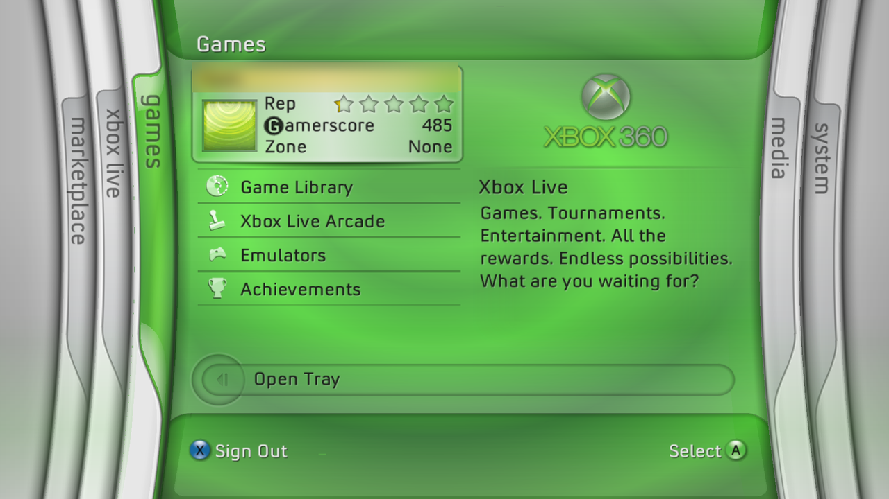

## What's SlopDash?

An AI-assisted recreation of the original Blades dashboard.

- The original blades, sounds and transitions
- The 2005 Guide, achievements included
- Plugin support
- Homebrew Marketplace blade
- File Manager
- Game library with trainers and title updates
- Emulator support
- Interchangeable with Aurora

## Work in progress

- RetroAchievements
- Trainers from the Guide
- USB keyboard and mouse
- ~~Screen recorder~~: not possible, hardware limitations

## What do you need?

- A softmodded Xbox 360 (BadUpdate, ABadAvatar)
- [SlopDash Importer](importer/README.md): bring your own assets

## Screenshots

<table>
  <tr>
    <td width="50%">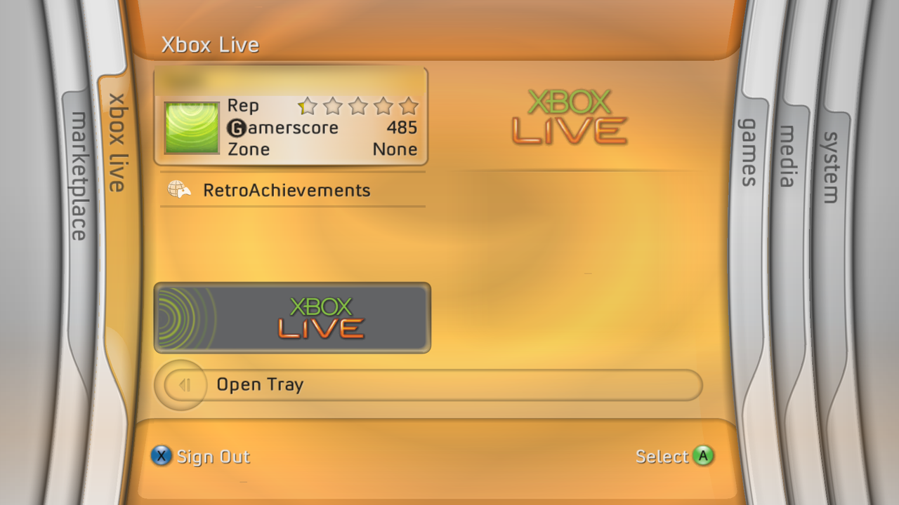 Xbox Live</td>
    <td width="50%">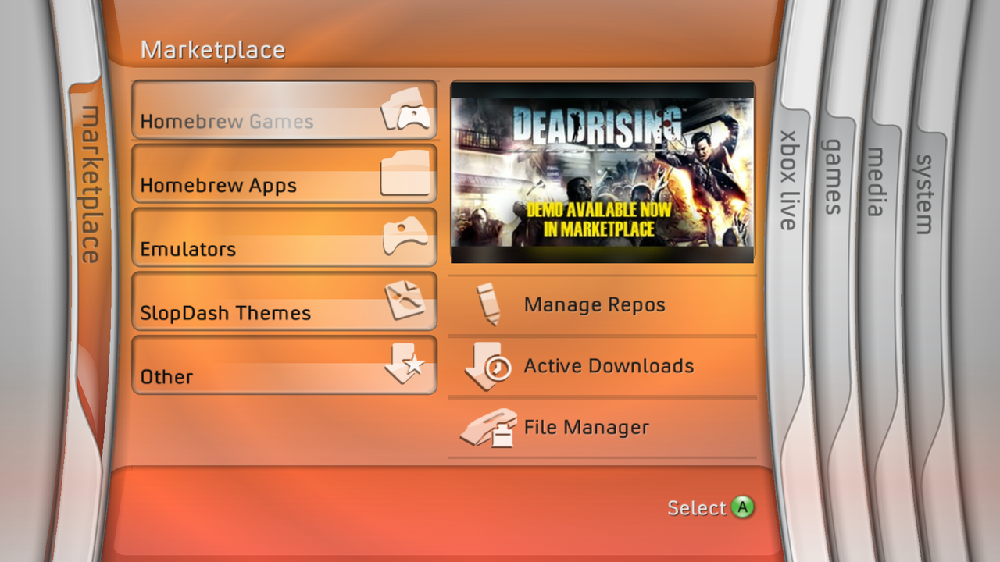 Marketplace</td>
  </tr>
  <tr>
    <td>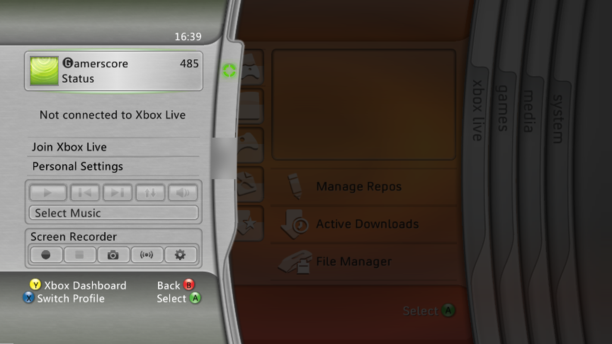 The Guide</td>
    <td>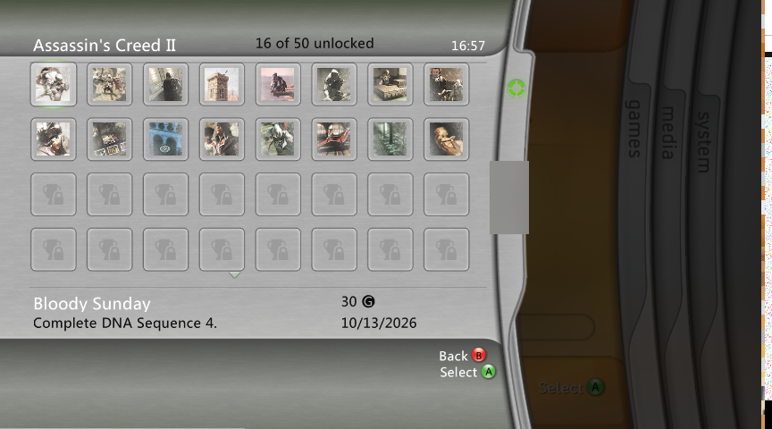 Achievements</td>
  </tr>
  <tr>
    <td>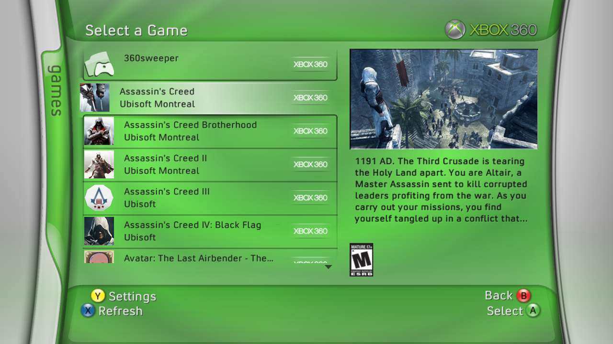 Game library</td>
    <td>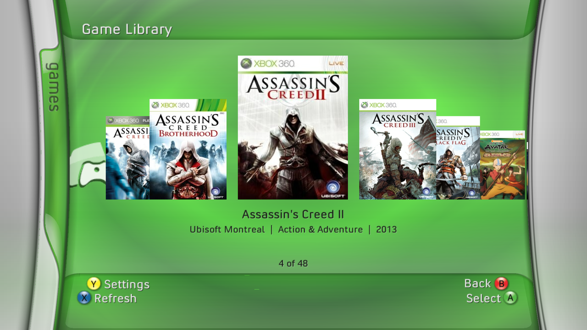 Cover Flow</td>
  </tr>
  <tr>
    <td>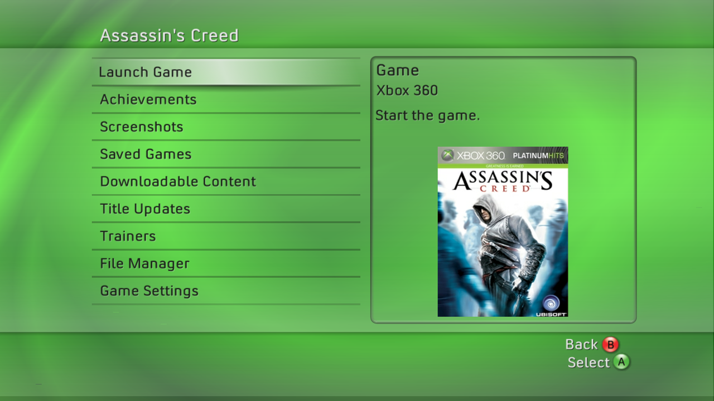 Game menu</td>
    <td>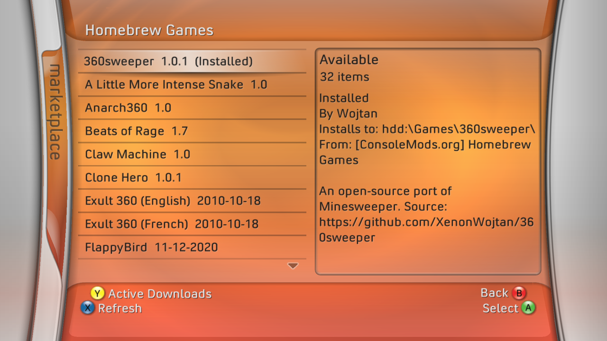 Homebrew Marketplace</td>
  </tr>
  <tr>
    <td>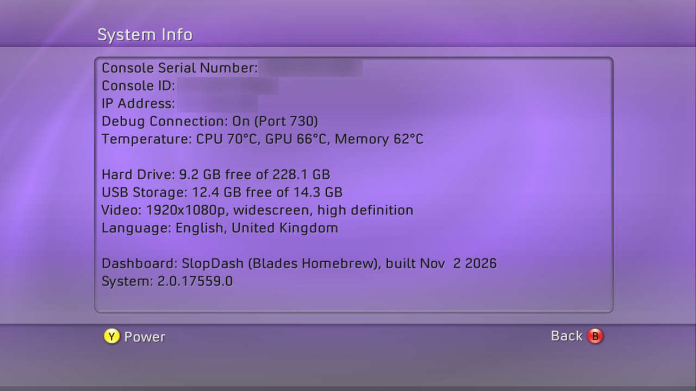 System Info</td>
    <td>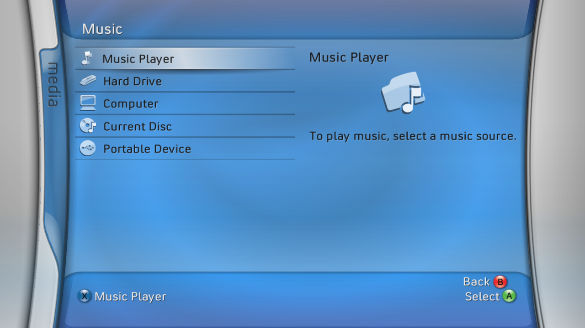 Media</td>
  </tr>
</table>

## Licence

- SlopDash: [GPL-3.0](LICENSE)
- [BearSSL](third_party/bearssl/LICENSE.txt): MIT
- [LZMA SDK](third_party/lzma/LICENSE.txt): public domain
- Building needs Microsoft's Xbox 360 SDK (XDK): not included, not covered by the GPL
- No Microsoft files are included: bring your own with the [importer](importer/README.md)
