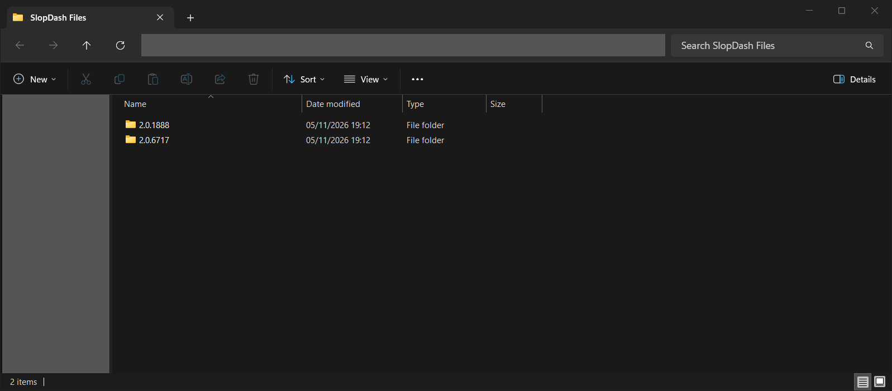
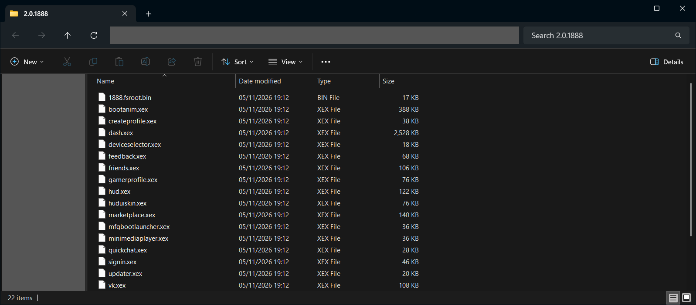
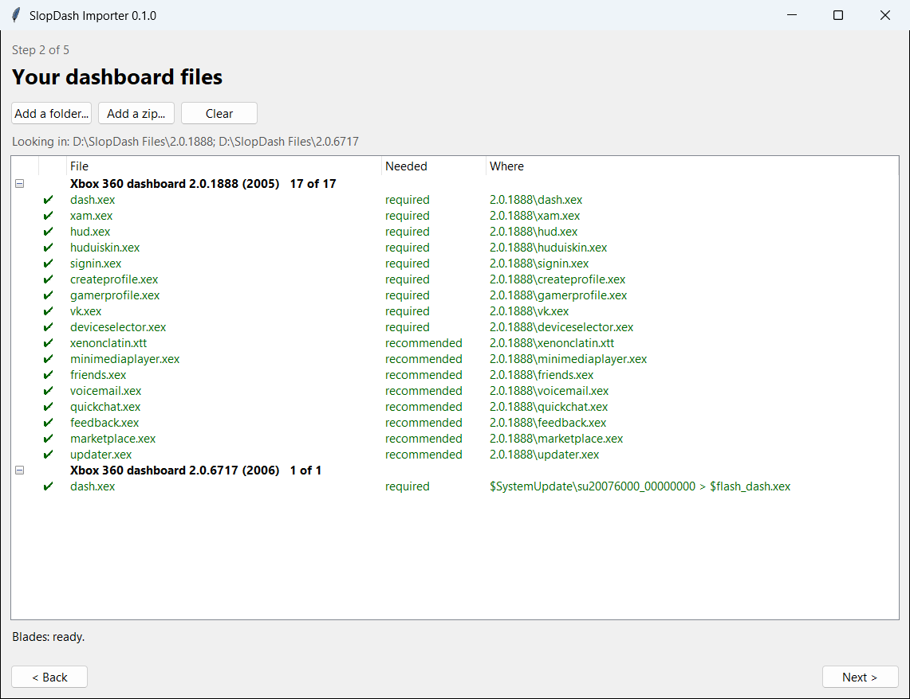
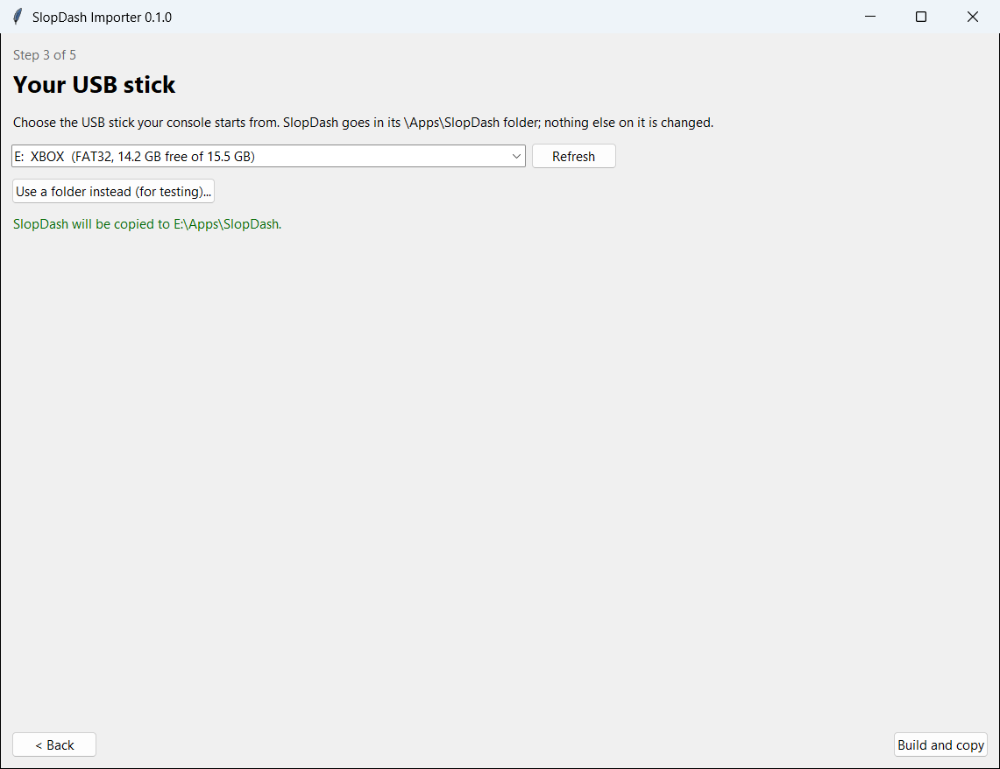
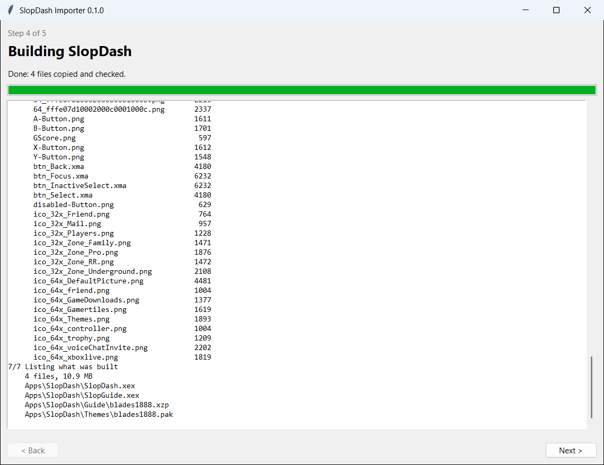
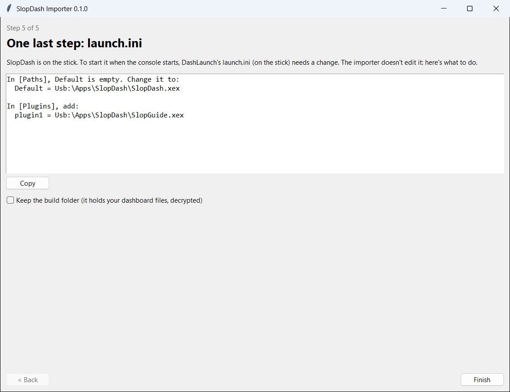
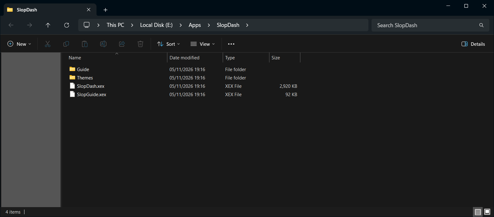

# SlopDash Importer

In order to comply with the grey area of copyright laws, SlopDash can't distribute Microsoft assets. You'll have to bring your own, but I've tried to make it as easy as possible with the importer tool.

## What this does

`SlopDash Importer.exe` takes the files you provide and builds the dashboard.

**[Download it](https://github.com/Springheel-Dev/Slopdash-Blades/releases/latest)**, or [build it yourself](REVIEW.md#building-it-yourself).

- One Windows exe, nothing to install
- Builds on your PC, copies to `\Apps\SlopDash` on your USB stick
- Shows the `launch.ini` lines to add; never edits it
- No console needed, nothing downloaded or uploaded

## Prerequisites

**Dashboard 2.0.1888** (17 files):
- `dash.xex`
- `xam.xex`
- `hud.xex`
- `huduiskin.xex`
- `signin.xex`
- `createprofile.xex`
- `gamerprofile.xex`
- `vk.xex`
- `deviceselector.xex`
- `xenonclatin.xtt`
- `minimediaplayer.xex`
- `friends.xex`
- `voicemail.xex`
- `quickchat.xex`
- `feedback.xex`
- `marketplace.xex`
- `updater.xex`

**Dashboard 2.0.6717** (1 file):
- `dash.xex`

**A FAT32 USB stick**: the one your console starts from.

## How to get them

- ~~Find them online~~
- **2.0.1888:** dump the flash (NAND) of a console on 2.0.1888 and unpack its file system. All 17 files are in that folder: point the importer at it.
- **2.0.6717:** take the 2.0.6717 system update file `$SystemUpdate\su20076000_00000000` as it is. No unpacking needed: the importer reads `dash.xex` out of it.

Names, folders and zips don't matter: files are recognised by their contents. Leave them as they are: the importer decrypts the encrypted `.xex` files itself. No XexTool needed, though copies you've decrypted or decompressed (with XexTool or another tool) work too.

## What to do

1. **Make a folder** with a subfolder for each version: the 2.0.1888 files, and the 2.0.6717 update file in `$SystemUpdate`.

   
   

2. **Run `SlopDash Importer.exe`** and add the two subfolders. Every file gets a tick; encrypted files are decrypted as the importer reads them.

   

3. **Pick your USB stick**, then **Build and copy**. (Or **Use a folder instead**, then copy its `Apps` folder to the stick.)

   
   

4. **Edit `launch.ini`** on the stick with the lines it shows.

   

5. **Check the stick:** `\Apps\SlopDash` holds `SlopDash.xex`, `SlopGuide.xex`, `Guide` and `Themes`.

   

6. **Start your console.**

*Screenshots: personal folders are hidden, and the "USB stick" here is a test copy shown as `E:`.*

How it works and how to check it: [REVIEW.md](REVIEW.md)
